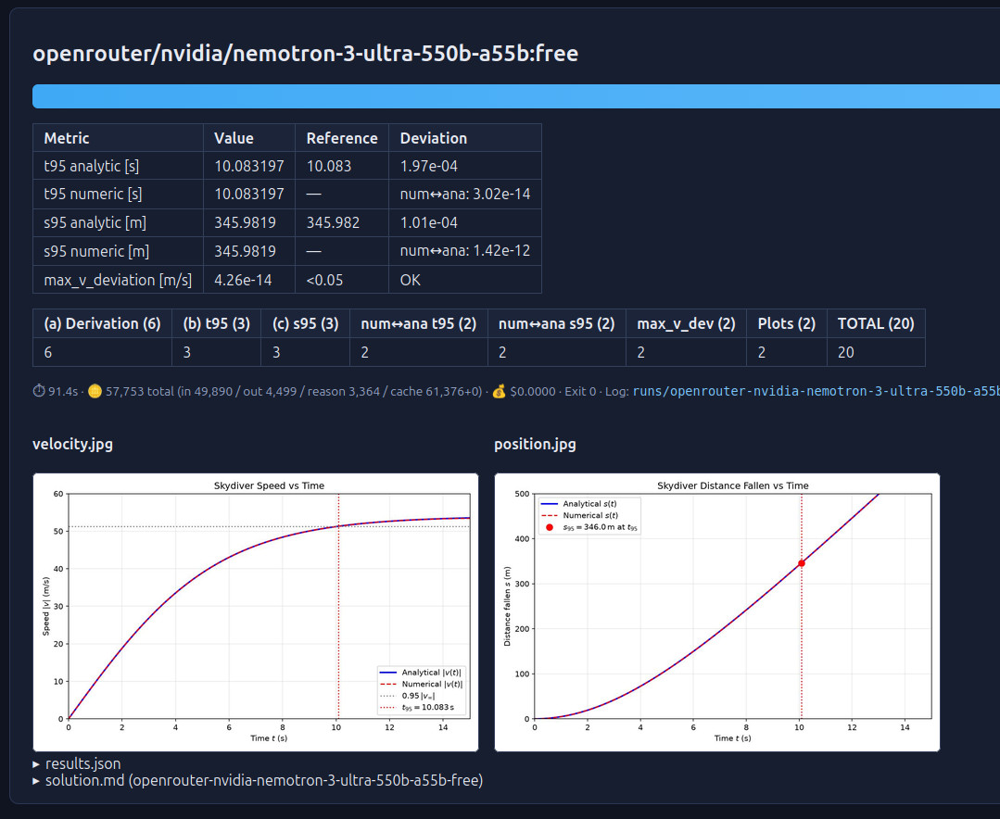

# Skydiver Benchmark – AI Model Comparison via OpenRouter + OpenCode



## Goal & Approach

**Goal:** Benchmark how well different AI models solve a physics problem end-to-end, both
analytically and numerically, and how well they cross-check the two against each other.

**The task** ([task.md](task.md)): A skydiver falls from 3000 m under quadratic drag
$F_z = -mg + \alpha v^2$. The agent must derive $v(t)$ analytically (terminal velocity,
time to reach 95 % of it, distance fallen) and solve the same problem numerically in Python,
then compare both solutions.

**The approach:** `run_benchmark.py` sends [task.md](task.md) to each model via the OpenCode
CLI (OpenRouter provider) in an isolated run directory. Each agent produces a
`solution/` folder (derivation, simulation, plots, `results.json`), which is then scored
automatically against the reference values using the criteria in
[evaluation.md](evaluation.md) (max. 20 points). Finally, a results website
(`website/index.html`) is generated comparing all models.

## Prerequisites

1. **OpenCode CLI** installed (`opencode --version`, here v2.2.5): `~/.opencode/bin` on PATH.
2. **OpenRouter provider configured in OpenCode** (login/API key, e.g. via `opencode auth login`
   or `service.json` in `~/.config/opencode/`). List models: `opencode models --provider openrouter`.
3. Python 3 with `numpy`, `scipy`, `matplotlib` (needed by the `skydiver.py` the agents generate —
   executed in each model's run directory).

## Usage

```bash
# Default: two models (see DEFAULT_MODELS in the script)
python3 run_benchmark.py

# Rebuild only the website from existing runs/ (no new agent runs)
python3 run_benchmark.py --build-only
```

## Workflow per model

1. Working directory `runs/<model-slug>/` is created, `task.md` + `evaluation.md` are copied in,
   and it is turned into its own mini git repo via `git init` — so OpenCode uses this directory
   as project/working directory (otherwise the agent would write into the parent repo).
2. `opencode run --auto --standalone -m <model> -f task.md "<prompt>"` starts the agent there.
3. The prompt contains the **absolute** WORKDIR — the agent is told to create all files with
   absolute paths under it. Safety net: files that still land in the repo root (`solution/`) are
   moved into `runs/<model>/solution/` after each run (`harvest_from_root`).
4. The agent is supposed to produce `solution/{solution.md, skydiver.py, results.json, velocity.jpg,
   position.jpg}` and to run `skydiver.py`.
5. Fallback: if the agent wrote no files, `results.json` is extracted from its chat reply
   (`runs/<model>/opencode_output.jsonl`) and saved afterwards.
6. `results.json` is scored automatically according to `evaluation.md`:
   - (b) |t95 − 10.083 s| < 0.05 / 0.5 / 2 s → 3 / 2 / 1 points
   - (c) |s95 − 345.982 m| < 1 / 10 / 50 m → 3 / 2 / 1 points
   - Numerics ↔ analytics: |Δt95| < 0.05 s (2), |Δs95| < 1 m (2), max_v_deviation_ms < 0.05 (2)
   - (a) derivation, heuristic from `solution.md` (tanh formula 4 pts, limit behavior 2 pts)
   - plots present (2 pts) — **max. 20 points**
7. `website/index.html` + `website/summary.json` + `website/assets/` are generated (plots embedded).

## View the results

[website/index.html](website/index.html)
